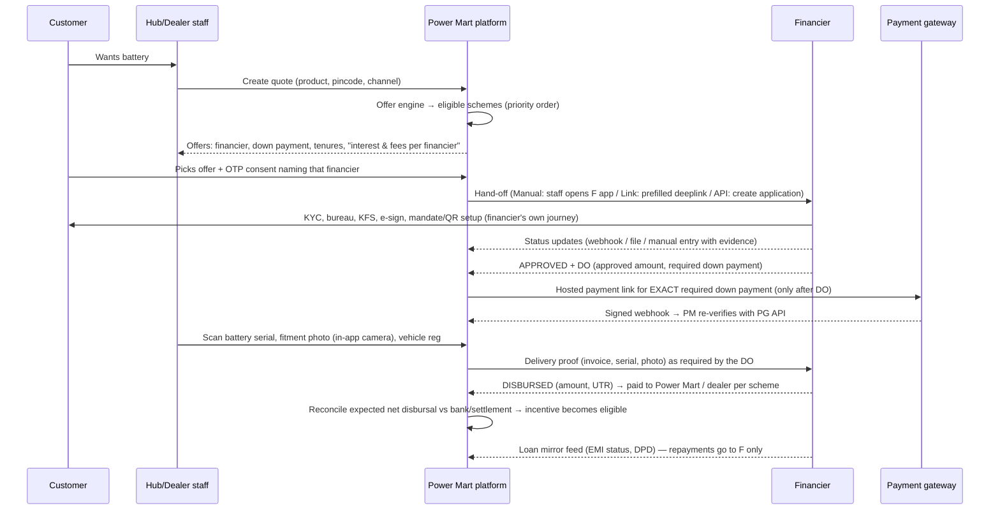

# Architecture 02 — Financier Integration (multi-financier, per product)

> Problem: each product can have a different financier, several financiers can serve one product, and financiers will be added, replaced, or retired over time. Power Mart must sell smoothly through all of them **without** becoming a lender, holding repayment money, or depending on any single financier's tech readiness.
> Decisions: D8–D13 in [discussion log](../discovery/05-discussion-log.md), [ADR-0002](../adr/0002-financier-plug-in.md).

---

## 1. How the big players do it (patterns we reuse)

| Pattern | Who uses it | How it works | What we take |
|---|---|---|---|
| **In-store consumer-durable finance** (closest to Power Mart) | Electronics and appliance chains, two-wheeler and auto dealers with NBFC partners | <ol><li>The customer chooses a product at the store.</li><li>The financier's app (run by the financier's rep or the store staff) does KYC and approval in minutes.</li><li>The financier issues a **delivery / release order (DO)** with the approved amount and the down payment the customer must pay the store.</li><li>The store collects the down payment, delivers, and invoices.</li><li>The financier **disburses to the store**, net of subvention or dealer charges.</li><li>Some financiers also require post-disbursal documents.</li></ol> | The **DO-driven flow**, disbursal to the seller, the down payment paid to the seller, and net-of-subvention reconciliation |
| **Online marketplace EMI / pay-later** | Large e-commerce platforms | <ol><li>An **offer engine** shows eligible finance options per product and price at checkout.</li><li>The customer picks an option and completes the **lender's own hosted journey** (KYC, consent, mandate).</li><li>The platform receives an approval or decline callback.</li><li>The merchant is paid by the lender or platform.</li><li>"No-cost EMI" means the brand or seller pays the interest as a discount (subvention).</li></ol> | The **offer engine**, the **lender abstraction** (one interface, many lenders), the **lender-hosted journey** (we never touch KYC), and the subvention concept |
| **Dealer management systems** (auto) | Vehicle dealers | <ol><li>Each model lists several financiers.</li><li>A "finance case" tracks status per financier.</li><li>DO and payout are tracked.</li><li>Post-disbursal documents are chased.</li></ol> | A **finance case per sale**, multiple financiers per product, and a document checklist per financier |

**Our design = the in-store DO flow + the marketplace's offer engine and lender abstraction + manual-first connectors.**

## 2. Core concepts (data model)

```
Product ─┐
         ├──< FinanceScheme (versioned) >── Financier ──1:1── IntegrationProfile (mode + status map, versioned)
Region ──┤        │
Channel ─┘        │ (chosen at quote time; version frozen)
                  ▼
Sale ──1:N── FinanceCase (one per financier attempt) ──1:N── FinanceEvent (append-only, raw + normalised)
                  │
                  ├── DeliveryOrder (approved amount, required down payment, net disbursal, expiry)
                  ├── Disbursal (expected vs received, UTR, reconciled?)
                  └── LoanMirror (read-only after disbursal: masked loan no, EMI, status, DPD bucket)
Consent (customer × financier × purpose × notice version)
```

| Entity | Key fields |
|---|---|
| **Financier** | `id`, legal name, type (NBFC, bank, platform), status (`draft`, `active`, `paused`, `retired`), regions, contacts, agreement ref and expiry, support SLA |
| **DealerEmpanelment** | dealer × financier: status (`pending`, `active`, `suspended`, `ended`), the financier's dealer code, documents, dates. **A dealer sees only the offers of financiers it is `active` with.** Empanelment is the financier's process; we track it and show the client which dealers are still pending |
| **IntegrationProfile** | `mode` (`manual`, `link`, `file`, `api`), endpoints, secret refs (never values), webhook verification method, **status mapping table** (financier status → our status), required documents checklist, version |
| **FinanceScheme** | financier, products, regions or pincodes, channel (hub or dealer), `price_basis_paise`, down-payment rule (fixed or percent, min), tenures offered, **down-payment collector** (`power_mart`, `financier`, `dealer`), **disbursal beneficiary** (`power_mart`, `dealer`), subvention (who pays, amount or percent), processing-fee display text (from the financier), priority, eligibility rules, monthly caps, `effective_from`/`effective_to`, version, maker-checker approval |
| **FinanceCase** | sale, customer, scheme version (frozen), financier, consent id, `external_ref`, normalised status, raw status, attempt no., previous case (waterfall), timestamps, owner (staff) |
| **DeliveryOrder** | financier DO ref, approved loan amount, required down payment, expected net disbursal, expiry, documents required before disbursal |
| **LoanMirror** | financier, masked loan account, tenure, EMI as stated by the financier, next due, DPD bucket, closed? It is **read-only and never computed by us** |

## 3. Standard status language (every financier maps into this)

```
DRAFT → CONSENTED → SUBMITTED → IN_REVIEW ─┬─→ APPROVED (DO issued) → DOWN_PAYMENT_RECEIVED → FITTED/DELIVERED → DISBURSAL_PENDING → DISBURSED → ACTIVE_LOAN → CLOSED
                                           ├─→ REJECTED (reason category)
                                           ├─→ NEEDS_INFO → IN_REVIEW
                                           └─→ CANCELLED / EXPIRED (from any pre-disbursal state)
```
- Each financier's own statuses are mapped to these by config, in a versioned mapping table.
- An unmapped status raises an alert and parks the case in `IN_REVIEW`. It never crashes and is never silently ignored.
- Business rules hang off our statuses only. Dashboards, incentives, and dealer views work the same for every financier.

## 4. End-to-end flow



**Hard rules in this flow**
1. The down-payment link is generated **only after an approval or DO**, for the **exact** amount in the DO, and computed on the server. The customer never pays before the loan is approved (as on deck slide 12), so there is no refund mess on rejection.
2. A battery is **reserved** at approval and **assigned** at fitment by scan. It cannot be fitted without an approved case, unless the sale is a cash sale.
3. Disbursal is reconciled using the UTR against the bank statement or settlement report. A mismatch goes to the exceptions queue.
4. Incentives and referral payouts become eligible **only** after `DISBURSED` + fitment evidence + reconciliation.
5. Repayments are never shown as "pay here" from our system. We show the financier's official QR or link (from the financier) and the status.

## 5. Offer engine (which financier is shown)

Inputs: product, price, customer pincode, channel (hub or dealer and which one), date, and optionally the customer segment (new or repeat).
1. Filter schemes by:
   - status `active`;
   - effective dates;
   - product;
   - region or pincode;
   - channel;
   - financier `active`;
   - monthly cap not exceeded.
2. Apply eligibility rules (simple declarative rules in the scheme config, e.g. a pincode allow-list).
3. Sort by priority, which the client sets for business reasons such as subvention cost, approval rate, or relationship.
4. Return the offers. The quote **freezes the scheme version** and has an expiry (e.g. 7 days).

No credit decision happens in our engine. It only answers "which financier's scheme can be *offered* here". The credit decision is the financier's alone.

## 6. Rejection and multiple financiers (waterfall)

- **Sequential, not broadcast.** On `REJECTED`, staff can offer the next eligible financier. This needs **fresh consent** naming the new financier and creates a new FinanceCase linked to the previous one.
- **Why not send to all financiers at once?** Each application can trigger a hard credit enquiry. Several at once hurt the customer's credit score and share data more widely than needed. For our customers (daily earners, often thin credit files), sequential is fairer and safer.
- **Attempt cap:** a configurable number of attempts per customer per 30 days (default 2).
- **Rejection reasons:** we store only the category (e.g. `policy`, `bureau`, `documents`, `other`) as given by the financier. We never infer or label creditworthiness ourselves.

## 7. The four connection levels (the same contract, different adapters)

All levels implement one `FinancierConnector` port:
```ts
interface FinancierConnector {
  submit(case): Promise<SubmitResult>            // manual: returns "awaiting staff entry"
  fetchStatus(externalRef): Promise<RawStatus>   // manual: n/a; file: from last import
  parseWebhook(req): Promise<VerifiedEvent>      // api only; signature + replay checks
  importFile(file): Promise<VerifiedEvent[]>     // file only; schema-validated
  sendDeliveryProof(case, proof): Promise<void>  // manual: checklist task for staff
}
```

| Level | Staff experience | Our evidence and controls |
|---|---|---|
| **Manual** | Staff use the financier's app, then enter the reference and status in our app | Each status change needs evidence (a screenshot or the financier's SMS ID), and a **second person verifies** `APPROVED` and `DISBURSED` (maker-checker) |
| **Link** | We open the financier's journey with non-sensitive fields pre-filled (name, phone, product, amount; **no KYC**) | Return status via callback or manual entry |
| **File** | A daily CSV or SFTP exchange | Schema validation, row-level dedupe, a reconciliation report |
| **API** | Real-time | HMAC or mTLS, timestamp window, event-ID dedupe, re-fetch on critical events (see security doc 06) |

A financier moves **up** levels when volume justifies it. Domain code does not change, only the adapter.

## 8. Onboarding a new financier (playbook)

| Step | Who | Typical time |
|---|---|---|
| 1. Commercial agreement (rates, subvention, disbursal beneficiary, down-payment collector, DO and document requirements) | Client ↔ financier | Their timeline |
| 2. Collect the financier's data-security checklist. Share our due-diligence pack (architecture, VAPT, policies) | Pawan | 1–2 days |
| 3. Create the Financier + IntegrationProfile (Manual) + status mapping in the admin screen | Client ops (maker) + Power Mart HO (checker) | 1 hour |
| 4. Create schemes per product, region, and channel | Client ops (maker-checker) | 1 hour |
| 5. Staff briefing: the financier's app, the evidence rules | Hub manager | 1 day |
| 6. **Live in Manual mode** | — | Same day |
| 7. (Optional) Upgrade to File or API: get docs and a sandbox, build the adapter, run contract tests, UAT, switch on per region via flag | Us + the financier's tech team | 1–3 weeks |

**Retiring or replacing a financier:**
- Set its schemes' `effective_to`, so no new offers appear.
- Cases already in flight continue. Active loans stay mirrored until closed.
- The financier's status goes to `retired` only after its last loan closes. Its data is retained as the retention policy requires.

## 9. Money map (who pays whom)

| Flow | From → To | Through | Our role |
|---|---|---|---|
| Down payment | Customer → Power Mart (or the financier or dealer, per scheme) | Payment gateway, hosted | Generate the link; verify; reconcile |
| Loan disbursal | Financier → Power Mart or dealer (seller of the battery) | Financier's bank transfer | Record expected vs actual; reconcile by UTR |
| Subvention or dealer charges | Deducted by the financier from the disbursal (or invoiced) | — | Expected-amount calculation from the scheme config; reconcile |
| **EMI repayments** | Customer → **Financier only** | Financier's QR, mandate, or link | **Display status only. Never collect** |
| Dealer incentives, referral fees | Power Mart → dealer or referrer | Bank payout (payment gateway payouts or ERP) | Calculate, maker-checker, pay via finance team |

## 10. Edge cases we design for from day one
- **Quote expired, or price changed** between quote and DO: the quote freezes price and scheme. A new price needs a new quote.
- **DO expired** before fitment: the case goes to `EXPIRED` and the battery reservation is released.
- **The customer cancels after approval:** the financier cancels the loan. The down payment is refunded through the payment gateway refund API (maker-checker) and the battery is released.
- **The financier's system is down mid-journey:** switch that financier's profile to Manual (one toggle) and continue.
- **Duplicate application:** dedupe on the HMAC of the phone number plus the vehicle registration. Block, or warn and override with a reason.
- **Disbursal amount differs from expected:** the exceptions queue blocks the incentive until resolved.
- **The financier changes its status codes:** a new mapping version is added. Old events keep the old mapping.
- **Dealer sale where the financier pays the dealer:** we still track the DO and disbursal. Dealer stock and incentives are adjusted accordingly.

## 11. What the client sees (keep it this simple)
- **Admin screens:** "Financiers" (add, pause), "Schemes" (product → financier, down payment, tenures, dates, priority), "Finance cases" (pipeline by status), "Exceptions" (needs attention).
- **Hub screen:** "Select battery → see offers → customer picks → send to financier → track → collect down payment → fit → done."
- **The client never needs a developer to add a financier or change a scheme.**

## References
- Dealer-side disbursal and fast sanction at the point of sale: [Poonawalla Fincorp consumer durable launch (CXOToday)](https://cxotoday.com/press-release/poonawalla-fincorp-enters-consumer-durables-loans-market-to-accelerate-customer-acquisition-and-unlock-high-yield-growth/)
- Consumer durable loan flow overview: [Credgenics](https://blog.credgenics.com/what-is-a-consumer-durable-loan/)
- Disbursal net of subvention and margin money (an illustrative sanction letter, unverified source): [Scribd](https://www.scribd.com/document/810182026/INTIMATION-LETTER)
- EV battery financiers active in this segment (possible partners or competitors): [BatteryPool (E-Mobility+)](https://emobilityplus.com/2026/01/13/batterypool-brings-sachetized-ev-battery-financing-to-indias-commercial-mobility-sector/amp/), [Manba Finance](https://www.sahi.com/news/manba-finance-launches-battery-replacement-loans-for-electric-three-wheelers-416942-PE1_C)
- Lending infrastructure sold to lenders (only relevant if a financier uses it): [FinBox](https://www.finbox.in/about-us)
